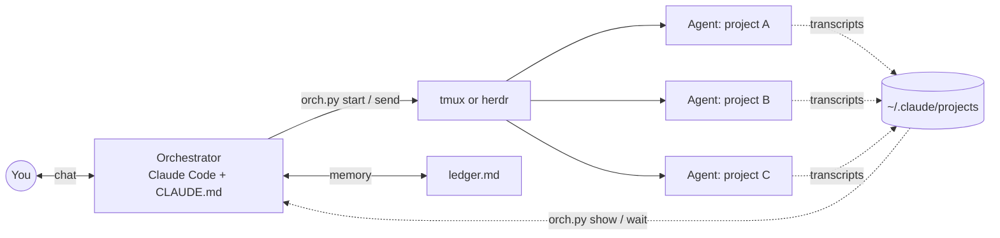

# Orchestrator starter

One Claude Code chat that runs all your other Claude Code chats.

You talk only to the orchestrator. It starts an agent in the right project folder, gives it one clear task, waits in the background, and reports back in one line per agent. When an agent needs your approval, the orchestrator shows you the question. It does not approve things for you.

📺 Video: _coming soon_ <!-- VIDEO_LINK -->
· Channel: [@byashanant on YouTube](https://www.youtube.com/@byashanant)



## Quick start

1. **Get it.**
   ```sh
   git clone https://github.com/anant1811/orchestrator-starter.git
   cd orchestrator-starter
   ```
2. **Set it up.** Start `claude` in this folder and paste the prompt from [SETUP.md](SETUP.md). Claude finds your projects, fills `aliases.json`, and tests one agent.
3. **Use it.** Start `claude` in this folder and ask for work: "Fix the failing test in blog", "status", "what does the api agent need from me?"

## What is in the box

| File | What it does |
| --- | --- |
| `CLAUDE.md` | The orchestrator's rules: routing, one task per agent, background waits, guard line, ledger, daily check. |
| `orch.py` | The tool: `status`, `show`, `send`, `wait`, `start`, `find`, `resume`, `projects`. Python standard library only. |
| `aliases.json` | Your project roots and nicknames. |
| `ledger.md` | The orchestrator's memory across chats and compactions. |
| `SETUP.md` | The setup prompt and the settings. |

## How it works

- **Agents** are normal interactive Claude Code chats. With tmux, each agent is a window in the `agents` session: run `tmux attach -t agents` to look at them. With [herdr](https://herdr.dev), each agent is a tab in the `Agents` space.
- **Replies** come from the Claude Code transcripts in `~/.claude/projects`, not from screen scraping.
- **Safety:** each prompt gets a guard line that forbids commit, push, deploy, publish and send. The orchestrator drops it only when you say yes to that specific action.
- **No interruptions:** `send` refuses an agent that is working, blocked, or on your screen, unless the orchestrator asks you first.

## Requirements

- macOS or Linux
- [Claude Code](https://docs.anthropic.com/en/docs/claude-code), signed in
- Python 3.8 or newer
- [tmux](https://github.com/tmux/tmux) 3.0 or newer (default), or herdr

## Licence

[MIT](LICENSE)
